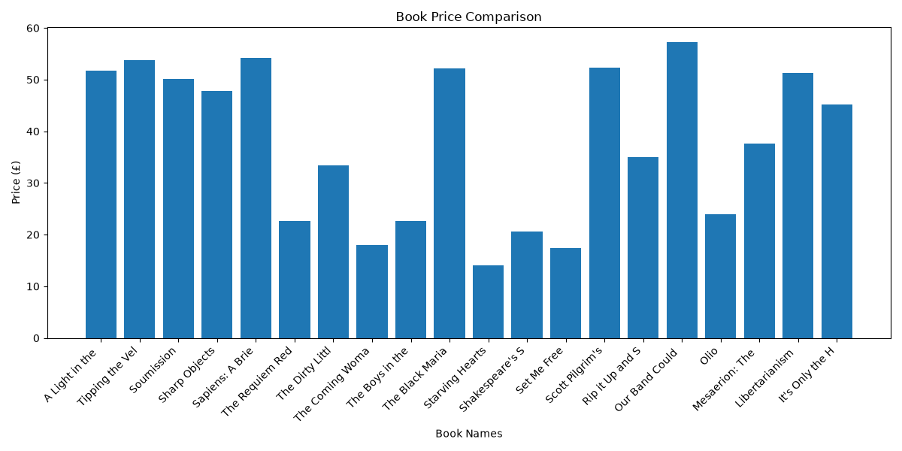

# 📚 Web Scraping and Data Visualization Tool

A beginner-friendly Python project that automatically extracts book information from a website, stores the collected data in a CSV file, and visualizes book prices using graphs.

## 📌 Project Overview

The **Web Scraping and Data Visualization Tool** is a Python-based project developed as part of a Project-Based Learning (PBL) activity.

The project uses web scraping techniques to collect book details from [Books to Scrape](https://books.toscrape.com/). The extracted information is then stored in a CSV file and represented using graphical visualizations.

The main aim is to demonstrate how Python can automate data collection and make information easier to understand through visualization.

## 🎯 Objectives

- To understand the basics of web scraping.
- To extract information from websites automatically.
- To collect book names, prices, and availability.
- To store extracted information in CSV format.
- To visualize collected data using Matplotlib.
- To understand basic data analysis and visualization.

## 🛠️ Technologies Used

| Technology | Purpose |
|---|---|
| Python | Main programming language |
| Requests | Connecting to websites |
| BeautifulSoup | Extracting information from HTML |
| Matplotlib | Creating graphs and charts |
| CSV | Storing extracted information |

## ✨ Features

- Automatic extraction of book information.
- Collection of book titles, prices, and availability.
- Storage of extracted data in a CSV file.
- Bar chart visualization of book prices.
- Automatic graph generation.
- Simple and beginner-friendly implementation.

## 📂 Project Structure

```text
Web-Scraping-and-Data-Visualization/
│
├── main.py
├── scraper.py
├── visualizer.py
├── products.csv
├── book_prices.png
├── requirements.txt
└── README.md
```

## ⚙️ Installation and Setup

### 1. Clone the repository

```bash
git clone https://github.com/mimansapandey-collab/Web-Scraping-and-Data-Visualization.git
```

### 2. Open the project folder

```bash
cd Web-Scraping-and-Data-Visualization
```

### 3. Install the required libraries

```bash
pip install -r requirements.txt
```

### 4. Run the project

```bash
python main.py
```

The program will automatically collect book information, save it in a CSV file, and generate a price comparison graph.

## 📊 Project Output

The project generates two main output files:

**1. products.csv**

Contains the extracted book information:
- Book Title
- Book Price
- Availability

**2. book_prices.png**

Contains a bar chart comparing the prices of the collected books.

## 🖥️ Sample Visualization



## 🔄 Working Process

1. **Website Connection:** Python Requests connects to the target website.
2. **HTML Parsing:** BeautifulSoup reads and parses the website's HTML.
3. **Data Extraction:** Book titles, prices, and availability are extracted.
4. **Data Storage:** The extracted information is stored in a CSV file.
5. **Data Visualization:** Matplotlib generates a bar chart showing book prices.

## 🎓 Learning Outcomes

Through this project, I learned:

- How web scraping works.
- How to use Python libraries such as Requests and BeautifulSoup.
- How to extract information from HTML elements.
- How to store data in CSV files.
- How to create graphs using Matplotlib.
- How to organize a Python project using multiple files.

## 🚀 Future Improvements

- Scrape data from multiple website pages.
- Add more types of graphs, such as pie charts.
- Include a user-friendly graphical interface.
- Add filtering and sorting options.
- Generate additional statistical reports.

## 👩‍💻 Project Information

**Project Title:** Web Scraping and Data Visualization Tool

**Project Type:** Python Project-Based Learning (PBL)

**GitHub Repository:** [Web Scraping and Data Visualization

